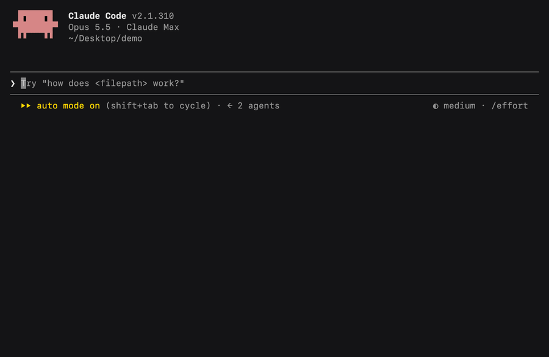

# Reminders for Claude Code: "remind me to…" with due dates above the prompt

Remind is a Claude Code mod that lets you tell Claude "remind me to renew the domain on Friday" and shows what's due in a line above the prompt. Reminders live in a local list or in your Apple Reminders.



## Install

In Claude Code:

```
/plugin install remind --marketplace hg913488/claude-code-reminders
```

Then just ask: "remind me to call the dentist tomorrow". Claude works out the date and adds it.

In the desktop app, click **+** next to the prompt box → **Plugins** → **Add marketplace** → `hg913488/claude-code-reminders` → **Add plugin**.

## How it works

- **Ask in plain words.** "Remind me to…", "don't let me forget…", "add a to-do". Claude turns "Friday" or "in 2 weeks" into a date. No date is fine too.
- **See what's due.** When something is due or overdue, a line above the prompt says so: `1 due · today: Renew the domain`. **All** opens the full list; **Hide** tucks it away.
- **Say when it's done.** "The dentist is done" marks it complete.
- **The pane.** `/remind` opens a side pane with your list, the current folder's git status (branch, changed files, commits to push or pull) and, if you set it up, your latest deploys.

## Settings

Open `/config` and find **remind**:

- **Where reminders live**:
  - `local` (the default) is a list Claude keeps in `~/.claude/remind/reminders.json`, on any computer.
  - `apple` uses the Reminders app on your Mac, so reminders sync to your iPhone.
- **Reminders list**: the Reminders app list to use with `apple`. Default `Claude`. It's created on your first reminder if it doesn't exist.
- **Repos to watch deploys for**: GitHub repos, comma-separated (`you/site, you/app`). Each one's latest production deploy shows in the pane as live, failed or in progress. Needs the [GitHub CLI](https://cli.github.com) signed in. Leave it empty and the deploys section doesn't show.

## FAQ

**How do I set reminders in Claude Code?**
Install the mod and say "remind me to…" with a date or without one. Claude adds it with the mod's `add_reminder` tool.

**Can Claude Code add to Apple Reminders?**
Yes. Set **Where reminders live** to `apple`. The first time, macOS asks whether your terminal may control Reminders: click OK. Reminders then sync to your iPhone like any other.

**Where is the local list kept?**
In `~/.claude/remind/reminders.json`, as plain JSON you can read or edit.

**Does it work on Windows or Linux?**
The local list does. The Apple Reminders option is macOS only.

**Why don't I see deploys?**
Add your repos under **Repos to watch deploys for**, and install and sign in to the GitHub CLI (`gh auth login`). Deploys are checked when you open the pane, when you press Refresh, and shortly after a `git push`.

**How do I uninstall it?**
`/plugin uninstall remind`, or `claude plugin uninstall remind` from a shell. Your local list stays in `~/.claude/remind/`.

## Watch it

[A 28-second tour: ask, see it due, mark it done](assets/reminders-tour.mp4)

---

MIT licensed. Made by [HG](https://github.com/hg913488). Not affiliated with Apple; Reminders is Apple's app, named here only to describe the integration.
